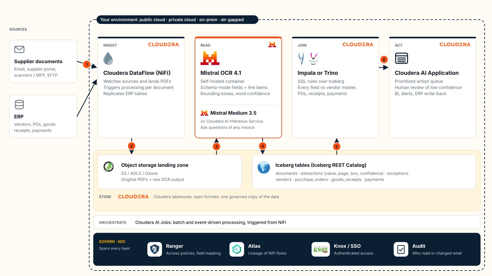

# Document AI on Cloudera: accounts payable with Mistral OCR 4.1

## Reference architecture



1. **Arrive:** an invoice reaches email, the supplier portal, a scanner or SFTP.
2. **Land:** Cloudera DataFlow (NiFi) writes the PDF to the governed landing zone.
3. **Read:** Mistral OCR 4.1 extracts fields, layout and confidence inside the environment.
4. **Store:** every field lands in Iceberg with its page, bounding box and confidence.
5. **Join:** SQL rules (Impala or Trino) check each field against the vendor master, POs, receipts and payments.
6. **Act:** the queue ranks actions; low-confidence fields go to a person; results flow back to the ERP.

This is the target pattern for a customer environment. The demo implements storage, rules and the app on Cloudera AI and
CDW, and calls Mistral OCR 4.1 through Mistral's API (see [Run on Cloudera AI](#run-on-cloudera-ai)). The diagram is generated by `ap/architecture.py`
(`python -m ap.architecture docs/architecture.svg`) and also appears in the app under *Under the hood → Architecture*.
Product names and logos are trademarks of their respective owners.

## Overview

Supplier invoices land as PDFs in the governed data lake. [Mistral OCR 4.1](https://docs.mistral.ai/capabilities/document_ai/basic_ocr)
reads them inside the environment and returns the fields as JSON, using a schema, plus layout blocks and word confidence.
Impala joins every field against enterprise data in Iceberg (vendor master, purchase orders, goods receipts, payments).
The result is a prioritized **action queue**. Each action links back to the exact spot on the page and to the record that
triggered it.

The point of the demo: extraction alone is another silo, and enterprise data alone can't read a PDF. Together they produce
an action with an audit trail.

| OCR 4.1 capability | What it does in the demo |
|---|---|
| Schema mode (`document_annotation_format` + prompt) | Extracts the invoice fields and line items |
| Layout blocks with bounding boxes | Click-to-evidence: each flag highlights its spot on the page |
| Word confidence scores | Low-confidence key fields go to human review instead of payment |
| Self-hostable in one container | The documents never leave the environment |

## Layout

| Path | What it does |
|---|---|
| `data/ap/` | The synthetic AP data the demo ships with: enterprise tables as CSVs, 40 batch invoice PDFs, 4 held-back live samples, `ground_truth.json` |
| `ap/generate.py` | Regenerates `data/ap/` from one seed: vendors, POs, receipts, payment history, invoice PDFs (5 layouts, scans, a 2-page invoice) with planted issues, plus the ground truth |
| `ap/setup_lake.py` | Creates the Iceberg tables in `docai_ap`, loads the enterprise data, lands the batch PDFs in S3 |
| `ap/pipeline.py` | PDF in S3 → OCR 4.1 (schema mode) → `extractions` with page/bbox/confidence → rules. Batch CLI and the live `ingest()` path |
| `ap/rules.sql` | The joins that produce `exceptions`: bank mismatch, duplicate, unknown vendor, no PO, price over PO, qty over receipt, low confidence, discount window |
| `ap/evidence.py` | Ties each extracted value to its OCR 4.1 block, line or table row, bounding box and word confidence |
| `ap/evaluate.py` | Scores extraction and the action queue against the ground truth |
| `app.py` | Web app: a FastAPI API over `ap/` (action queue, evidence, review, ingest, chat, tables, accuracy) that also serves the front end |
| `static/` | Front end: plain HTML, CSS and JavaScript modules (no build step), fonts and logos |
| `ap/architecture.py` | The reference architecture diagram (SVG with embedded logos and font), used by the app and `docs/architecture.svg` |
| `ap/brand.py` | Cloudera + Mistral palette; the app gets it as CSS variables from `/brand.css` |
| `ap/preflight.py` | Checks the project can run the demo: Python version, Mistral key and OCR model, Impala connection, data lake write access |
| `.project-metadata.yaml` | The AMP definition: launch form, runtime, and the setup steps below |
| `setup_demo.py`, `run_pipeline.py`, `launch_app.py` | Entry points for the setup Job, the "AP pipeline" Job and the Application |
| `deploy_app.py` | Creates or updates the Application and the "AP pipeline" Job in an existing project (for development) |

Settings are in `ap/config.py`, overridable by environment variable: data lake folder (`AP_S3_ROOT`, default
`<data lake bucket>/user/<your user>/docai`), database (`AP_DB`, default `docai_ap`), Impala data connection
(`AP_IMPALA_CONNECTION`), business date (`AP_AS_OF`) and review threshold (`AP_MIN_CONFIDENCE`).

## Launch as an AMP

The repo is an AMP (Accelerator for ML Projects): a new Cloudera AI project can set itself up from the GitHub URL.

**You need:** a Cloudera AI workbench in a CDP environment with data lake access (IDBroker), a CDW Impala Virtual
Warehouse that shows up as a data connection, the Python 3.12 runtime (3.11 or later works), outbound HTTPS to
`api.mistral.ai`, and a Mistral API key with access to OCR 4.1.

1. In Cloudera AI: **New Project**, choose **AMPs** under *Initial Setup*, and paste
   `https://github.com/neelabhpant/Mistral_DocumentAI`. Create the project.
2. Fill in the form: `MISTRAL_API_KEY`, the name of your Impala data connection (`AP_IMPALA_CONNECTION`), and the
   database (`AP_DB`). Leave `AP_S3_ROOT` blank to use your folder in the data lake. **Launch Project.**
3. The launch runs these steps (about 10 minutes):
   - **AP setup** job (`setup_demo.py`): installs `requirements.txt`, runs the preflight checks, creates the Iceberg
     tables, loads the enterprise data and lands the 40 batch invoices in the data lake.
   - **AP pipeline** job (`run_pipeline.py`): Mistral OCR 4.1 reads each invoice, and the rules build the action queue.
   - **Application** (`launch_app.py`): the web app. Open it from the project's *Applications* page.

Setup drops and recreates the tables in `AP_DB`. If someone else already runs the demo in the same environment, give
yours another database name. If a step fails, its job log says what to change: fix the project environment variable
(Project Settings > Advanced) and retry the step, or check from a session with `python -m ap.preflight`. Some Cloudera AI
versions save values typed into the launch form as a browser event instead of the text; the setup job reports this
first, and the fix is the same.

## Run on Cloudera AI

To set up an existing project by hand instead: set `MISTRAL_API_KEY` as a project environment variable
(Project Settings > Advanced) and restart your session.

```bash
python -m ap.preflight                        # Mistral key, Impala connection, data lake access
python -m ap.setup_lake --reset               # Iceberg tables + PDFs in S3, from the shipped data/ap/
python -m ap.pipeline --pending               # OCR 4.1 + rules (or run the "AP pipeline" Job)
python -m ap.evaluate                         # accuracy vs ground truth
python deploy_app.py                          # Application + Job
```

`python -m ap.generate --vendors 15 --seed 7` regenerates `data/ap/`. With that seed you get the data the repo ships:
the same tables and ground truth, and PDFs that render identically.

The app and the Job run on a Python 3.12 runtime and install `requirements.txt` on first start (`ensure_deps.py`).

## Demo flow

1. **Action queue**: 40 invoices processed, 9 planted issues found, 2 sent to review. Open the bank-change invoice (B021): the remit-to
   account is highlighted on the page, next to the vendor master record that disagrees.
2. **Human review**: B001 is a smudged fax. OCR 4.1 misread the invoice number (A05319 instead of A05519) but with low confidence,
   so it went to a person instead of to payment. Confirm the value and the rules rerun.
3. **Ingest an invoice**: pick a held-back sample (`data/ap/live/`), for example L043. It lands in S3, OCR 4.1 reads it, and the rules flag it
   within seconds, using the same code as the batch Job.
4. **Under the hood**: the OCR output, the schema and prompt, chat with the invoice, the Iceberg tables, the SQL rules, and the accuracy score.
   **Remove live uploads** resets the demo.

## Tests

The tests run the real app and `ap/` code on stand-ins for Impala (SQLite), S3 (a temporary folder) and the Mistral
API (`tests/fakes.py`), so they need neither Cloudera nor a Mistral key:

```bash
pip install -r requirements-dev.txt
python -m unittest discover -s tests -t . -v   # API, pipeline and rules
node --test                                    # the front end's markdown renderer
```
